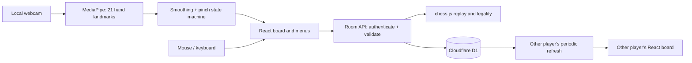

# Architecture

## Camera and gestures

`use-hand-tracking.ts` acquires video without audio and sends at most one frame at a time to a local Web Worker. Camera-frame callbacks replace the prior 20 FPS throttle, with a requestAnimationFrame fallback. Busy frames are skipped instead of queued. Local MediaPipe model/WASM files detect up to two hands. Camera images never go to an AirChess endpoint. GPU inference falls back to CPU when unavailable. `scripts/build-hand-worker.mjs` bundles a classic worker for both dev and production because MediaPipe's WASM loader uses `importScripts`.

Calibration requires a single detected hand with thumb/index apart for 300 ms. Its handedness becomes the control role. The second open palm pauses input immediately, preserving any selected chess piece. It must be lowered for 350 ms before resuming. Missing or ambiguous controller labels reset pending confirmation, without dropping the selected piece. Handedness prediction can still be wrong under occlusion.

`lib/air-pointer.ts` maps landmarks into the video's actual bounding rectangle, accounting for mirroring, crop, and scrollbar width. Optional expanded reach defaults off. Time-based smoothing follows large movements quickly and softens small tremors. Cursor movement is never gated by thumb distance; this fixes the prior freeze for a naturally curled thumb.

The default steady-hover mode requires 1.1 seconds continuously inside the central 88% of an eligible square. A visible ring and progress bar fill during this interval. Leaving, pausing, or losing the controller resets the timer. Activated squares stay latched until the pointer leaves, so source selection does not immediately toggle itself off.

Optional double pinch uses the existing 0.38/0.65 thresholds and 90 ms debounce. The pre-pinch target settles for 160 ms; two complete close/open cycles confirm it within 3.5 seconds. Target locking is separate from pointer rendering: a curling fingertip cannot change a locked target. A held pinch over 1.5 seconds or palm drift beyond max(24px, 65% of a square) cancels the sequence. Buttons keep a 1.3-second dwell. The selected piece survives detection dropouts, but unfinished input never commits after a dropout.

Both interaction modes call the actual page's `squareClick` function. Turn, selection, orientation, modal, game, or mode changes reset incomplete input. The integration harness in `tests/browser/gesture-qa.tsx` mounts that same page and hook with synthetic camera/model input; no test control is included in the production route.

## Game state

A `RoomState` stores SAN move history, explicit result, draw offer, rematch request, and game number. `replay` reconstructs the chess position from history. Retaining history allows threefold repetition detection; storing FEN alone would lose it.

All chess moves must pass chess.js legality. The server decides whose turn it is. Automatic repetition/fifty-move draws are a documented casual-play choice. There are no clocks and no automated opponent.

## Multiplayer protocol

- `POST /api/rooms` creates a room, reserving White for the requesting player.
- `POST /api/rooms/:code` with `type: join` atomically claims the Black seat.
- `GET /api/rooms/:code` returns state to an authenticated participant.
- `POST /api/rooms/:code` with `type: action`, `revision`, and `action` validates and applies a move or game command.

Every request carries a random player key in an Authorization header. The database stores its SHA-256 digest, not the key. Player digests are never returned in room responses. Keys are per-tab session state and are not account passwords.

Updates use `WHERE code = ? AND revision = ?`. Only one writer can change a given revision. A second simultaneous/stale request gets a conflict instead of silently overwriting the first. Join uses the same mechanism, so two visitors cannot both claim Black.

The client polls approximately every 900 ms when visible and every 4 seconds while hidden. Only one poll is in flight per effect; response revision checks prevent stale responses from rolling the board backward. Failed polls show reconnecting state and suppress moves. This is appropriate for casual turn-based chess; WebSockets would reduce latency for future timed modes.

## Storage and limits

D1 persists rooms through Worker restarts. Rooms become unavailable after seven days without a write. Expired rows are not yet physically purged. There is no matchmaking, spectator protocol, per-user rate limiter, or account recovery. Before a public launch these need explicit design. The initial hosted site is private and its hosting access policy is independent of game room membership.

Local practice always uses the actual side to move, independent of hand identity or board orientation. Follow active side rotates the current color to the bottom. In online rooms the server still limits each player to their own color.

## Movable layout and rendering
`MovableSurface` applies translated offsets directly during pointer dragging, saves preferences on release/nudge, and clamps moved panels to the viewport. ResizeObserver and resize events keep saved layouts reachable. Layout events cancel unfinished gesture confirmation; arranging mode disables chess-square gestures while leaving menu nudges usable. Active pointer dragging pauses all air input. Hit testing always uses the actual translated square rectangle, so moving the board does not add a separate coordinate offset.

Legal moves and game history are memoized by position/selection; board elements rerender for board/target changes, not every progress tick. Feedback percentages are coarsened without changing the confirmation timer or imperative cursor progress ring. Video-frame callbacks are cancelled with camera shutdown. The FPS and capture-to-result delay are measured, not advertised capabilities. No model simplification or resolution reduction is used.
