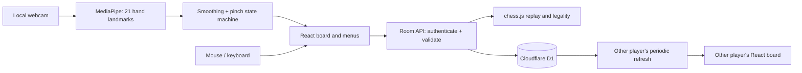

# Architecture

## Camera and gestures

`use-hand-tracking.ts` acquires video without audio. Model and WebAssembly files are served locally by this app. Only one hand is tracked. Images are passed directly to local model inference and are not sent to any AirChess endpoint.

The camera is mirrored and fills the viewport with `object-fit: cover`. `projectPoint` accounts for the horizontal mirror and image cropping. It gives screen coordinates that match the displayed fingertip. An exponential smoother reduces cursor jitter.

Pinch distance is divided by palm width to reduce sensitivity to distance from the camera. Closing below 0.38 for 90 ms grabs; opening above 0.65 for 90 ms releases. This separate closing/opening threshold is called **hysteresis**: it prevents rapid toggles near a boundary. A newly detected hand must open before it can grab. Losing tracking for over 180 ms cancels a pickup and requires rearming.

Buttons use a 1.3-second open-hand hover. Board squares do not use hover activation. This keeps a slow hand crossing the board from accidentally clicking a piece. The same move function serves pointer and gesture controls. Promotion has a separate gesture-friendly dialog.

Inference runs on the main thread, limited to about 25 FPS, using GPU when possible and CPU fallback otherwise. Moving inference into a Web Worker is a useful future performance improvement. The current thresholds are starting values, not results of a user study.

## Game state

A `RoomState` stores SAN move history, explicit result, draw offer, rematch request, and game number. `replay` reconstructs the chess position from history. Retaining history allows threefold repetition detection; storing FEN alone would lose it.

All chess moves must pass chess.js legality. The server decides whose turn it is. Automatic repetition/fifty-move draws are a documented casual-play choice. There are no clocks and no automated opponent.

## Multiplayer protocol

- `POST /api/rooms` creates a room, reserving White for the requesting player.
- `POST /api/rooms/:code` with `type: join` atomically claims the Black seat.
- `GET /api/rooms/:code` returns state to an authenticated participant.
- `POST /api/rooms/:code` with `type: action`, `revision`, and `action` validates and applies a move or game command.

Every request carries a random player key in an Authorization header. The database stores its SHA-256 digest, not the key. Player digests are never returned in room responses. Keys are per-tab session state and are not account passwords.

Updates use `WHERE code = ? AND revision = ?`. Only one writer can change a given revision. A second simultaneous/stale request gets a conflict instead of silently overwriting the first. Join uses the same mechanism, so two visitors cannot both claim Black.

The client polls approximately every 900 ms when visible and every 4 seconds while hidden. Only one poll is in flight per effect; response revision checks prevent stale responses from rolling the board backward. Failed polls show reconnecting state and suppress moves. This is appropriate for casual turn-based chess; WebSockets would reduce latency for future timed modes.

## Storage and limits

D1 persists rooms through Worker restarts. Rooms become unavailable after seven days without a write. Expired rows are not yet physically purged. There is no matchmaking, spectator protocol, per-user rate limiter, or account recovery. Before a public launch these need explicit design. The initial hosted site is private and its hosting access policy is independent of game room membership.
