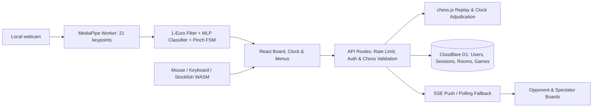

# Architecture

## Camera, gestures, and AI workers

- **Hand tracking (`hooks/use-hand-tracking.ts`, `workers/hand-tracking.worker.ts`)**: Captures webcam video without audio (`requestVideoFrameCallback` + stalled-frame watchdog), downscales frames above target width (`384p` Fast default or `512p` Crisp via `createImageBitmap`), and transfers at most one bitmap at a time to a classic Web Worker bundled via `scripts/build-hand-worker.mjs`. In `Auto` mode, measures real worker inference latency (`inferenceMs`) across initial frames and switches automatically between WebGL `GPU` and SIMD WASM `CPU` when integrated GPU readback exceeds 50 ms/frame, caching the fastest backend locally (manual `Auto / GPU / CPU` override available in Settings). Defaults to single-hand tracking (`numHands: 1`) and batches skeleton canvas rendering into one stroke per hand with cached video geometry. Camera frames never leave the browser.
- **Cursor smoothing & stability (`lib/air-pointer.ts`, `lib/gestures.ts`, `lib/double-pinch.ts`)**: Projects mirrored coordinates into the cached video rectangle (`object-fit: cover` crop), applies adaptive **One-Euro (`1€`) filtering** (`minCutoff = 1.0`, `beta = 0.016`, plus sub-2.2 px stationary tremor damping), scales palm-jump thresholds by frame `dt` (`exceededPalmJump`), tolerates single-hand Left/Right handedness flickers (`resolveControllerHand`, `280 ms` hold), applies 12% hover square hysteresis across borders, and supports both `1.1s` / `0.7s` Steady Hover and locked Double Pinch.
- **Custom gesture MLP (`lib/gesture-features.ts`, `lib/gesture-classifier.ts`, `scripts/train-gesture-classifier.ts`)**: Extracts 26 palm-basis invariant geometric features from the 21 keypoints and runs a tiny trained 2-layer MLP (`26 → 24 ReLU → 4 Softmax`, `open` / `pinch` / `fist` / `peace`) with temporal probability smoothing (`GestureSmoother`), driving live confidence badges, pinch fusion, and a 450 ms **fist-hold cancel** gesture. Settings also includes a landmark sample recorder/JSON exporter (`captureSample`).
- **Local Stockfish engine (`hooks/use-stockfish.ts`, `workers/stockfish.worker.ts`)**: Runs `stockfish.js` (WASM/asm.js) in a dedicated Web Worker with `Casual` / `Club` / `Master` difficulty presets, evaluation normalization, and post-game or solo best-move hints (disabled during active multiplayer matches).

## Game state, clocks, and openings

`RoomState` retains full SAN move history, game result, draw offers, rematch flags, game counter, and `ClockState` (`wMs`, `bMs`, `incrementMs`, `lastTickAt`). Keeping full SAN history enables `chess.js` repetition and fifty-move adjudication as well as client-side ECO opening classification (`lib/openings.ts`).

For timed games (`blitz3_2`, `blitz5_0`, `rapid10_0`), clocks derive elapsed time relative to server `lastTickAt` timestamps synced via `serverNow`. In the UI, `MatchClock` (`components/chess-board.tsx`) isolates the 100 ms countdown inside the two clock badges while `app/page.tsx` schedules a single timeout for auto-flagging—preventing 10 Hz full-board re-renders.

## Multiplayer, SSE streaming, and accounts

- **Room API & concurrency (`lib/room-service.ts`, `app/api/rooms/`)**: Uses per-tab random bearer keys hashed with SHA-256 and compare-and-swap SQLite updates (`WHERE code = ? AND revision = ?`) to guarantee atomic White/Black seat joins, legal turns, and timeout flags. Expired rooms (older than 7 days) are cleaned up opportunistically.
- **Real-time delivery (`app/api/rooms/[code]/events/route.ts`)**: Streams `Server-Sent Events` combining instant in-isolate pub/sub wakeups with single-query `readRoomIfNewer` D1 change detection and automatic client polling fallback + `visibilitychange` fast catch-up. Spectators connect read-only via `?watch=1`.
- **Accounts, archives & Elo (`lib/auth.ts`, `lib/elo.ts`, `app/api/auth/`, `app/api/games/`)**: Supports optional salted PBKDF2-SHA256 registration/login (100k iterations, constant-time verification including a dummy hash check for unknown usernames, expired-session pruning, and `HttpOnly; SameSite=Lax` D1 session cookies), K=32 Elo updates on finished rated rooms, server-validated AI/multiplayer archiving, replay URLs (`/?game=<id>`), and leaderboard queries.
- **Rate limiting & health (`lib/rate-limit.ts`, `app/api/health/route.ts`)**: Protects registration/login (`40 req/min/IP`) and room creation (`60 req/min/IP`) with sliding-window isolate limits (`429` + `Retry-After`) and exposes `GET /api/health` checking D1 `SELECT 1`.

## Movable layout & rendering

`MovableSurface` provides GPU-accelerated drag and keyboard/air-button nudges persisted per panel and clamped within the viewport (`ResizeObserver`). `ChessBoard` and `SidebarPanels` are memoized (`React.memo`), keyboard shortcuts handle navigation/utility keys cleanly, and `app/error.tsx` / `app/not-found.tsx` handle unexpected failures and missing routes gracefully.
