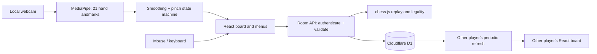

# Architecture

## Camera and gestures

`use-hand-tracking.ts` acquires video without audio and sends at most one frame at a time to a local Web Worker, capped at 20 FPS. Local MediaPipe model/WASM files detect up to two hands. Camera images never go to an AirChess endpoint. GPU inference falls back to CPU when unavailable. `scripts/build-hand-worker.mjs` bundles a classic worker for both dev and production because MediaPipe's WASM loader uses `importScripts`.

Calibration requires a single open hand for 500 ms. Its handedness becomes the control role; a second open palm only activates piece/hint animations. Missing or duplicate controller labels cancel the sequence rather than handing control to the helper. Handedness prediction can still be wrong under occlusion, so device testing remains necessary.

The mirrored camera fills the viewport with `object-fit: cover`; `projectPoint` accounts for mirroring and crop. Optional reach assist expands the central 76% to the viewport, but defaults off. Cursor smoothing applies while fingers are open, then freezes during pinching to prevent fingertip curl from changing the aimed square. Pinch distances account for camera aspect ratio and are normalized by palm width.

`lib/gestures.ts` uses 0.38 closing and 0.65 opening thresholds, each stable for 90 ms. `lib/double-pinch.ts` requires an eligible square's central 64% to be targeted for 320 ms before locking it on the first pinch. Two complete close/open cycles confirm that same square. Palm drift beyond 32% of a square, a pinch held over 800 ms, a sequence over 2.2 seconds, or tracking loss cancels the attempt. A cooldown separates attempts. Source, turn, game, orientation, or modal changes reset a pending sequence. Only current-turn pieces and legal destinations are eligible.

Buttons retain 1.3-second open-finger dwell, available only to the controller. The same `squareClick` path serves pointer and confirmed gesture actions. Selection then destination each require their own double pinch; promotions use the gesture-friendly dialog. A visible coordinate/progress indicator helps the user see which square will be confirmed. These thresholds are conservative starting values, not measured accuracy results.

## Game state

A `RoomState` stores SAN move history, explicit result, draw offer, rematch request, and game number. `replay` reconstructs the chess position from history. Retaining history allows threefold repetition detection; storing FEN alone would lose it.

All chess moves must pass chess.js legality. The server decides whose turn it is. Automatic repetition/fifty-move draws are a documented casual-play choice. There are no clocks and no automated opponent.

## Multiplayer protocol

- `POST /api/rooms` creates a room, reserving White for the requesting player.
- `POST /api/rooms/:code` with `type: join` atomically claims the Black seat.
- `GET /api/rooms/:code` returns state to an authenticated participant.
- `POST /api/rooms/:code` with `type: action`, `revision`, and `action` validates and applies a move or game command.

Every request carries a random player key in an Authorization header. The database stores its SHA-256 digest, not the key. Player digests are never returned in room responses. Keys are per-tab session state and are not account passwords.

Updates use `WHERE code = ? AND revision = ?`. Only one writer can change a given revision. A second simultaneous/stale request gets a conflict instead of silently overwriting the first. Join uses the same mechanism, so two visitors cannot both claim Black.

The client polls approximately every 900 ms when visible and every 4 seconds while hidden. Only one poll is in flight per effect; response revision checks prevent stale responses from rolling the board backward. Failed polls show reconnecting state and suppress moves. This is appropriate for casual turn-based chess; WebSockets would reduce latency for future timed modes.

## Storage and limits

D1 persists rooms through Worker restarts. Rooms become unavailable after seven days without a write. Expired rows are not yet physically purged. There is no matchmaking, spectator protocol, per-user rate limiter, or account recovery. Before a public launch these need explicit design. The initial hosted site is private and its hosting access policy is independent of game room membership.

Local practice always uses the actual side to move, independent of hand identity or board orientation. Follow active side rotates the current color to the bottom. In online rooms the server still limits each player to their own color.
